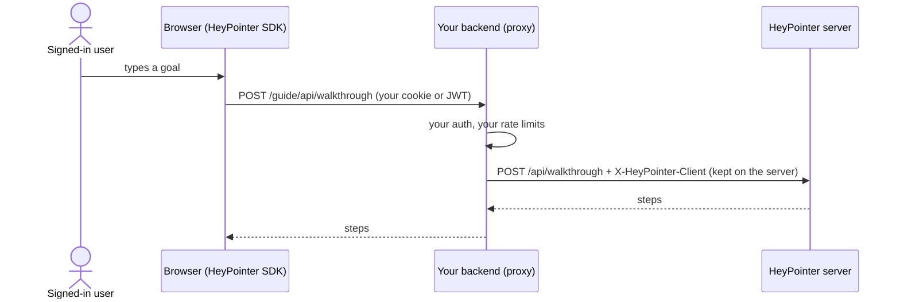

# Put your own backend in front of HeyPointer (web and native apps)

A client ID in a web page or an APK is visible to anyone who looks, so it can identify and meter a client but cannot keep strangers out. For web and native apps alike the recommended setup is for **your own backend to proxy the guide's requests** and apply **your own authentication** (session cookie, JWT, SSO). Who may use the guide is then decided by your app, not by HeyPointer.



With a proxy the client ID never reaches the browser, so it behaves like a private credential. HeyPointer still checks it, applies its per-client rate limit and can revoke it.

**A guide key is better for a proxy.** Your tenant can mint a `guide` key (`heypointer keys create --name my-backend --scope guide`, shown once). It is a real secret, can be rotated or revoked on its own, has its own rate limit, needs no origin rules, and the walkthrough route accepts it as `Authorization: Bearer gfk_g_...` instead of the client ID. It can only ask for walkthroughs; any other route answers 403. In the example below, replace the `x-heypointer-client` header with `authorization: \`Bearer ${process.env.HEYPOINTER_GUIDE_KEY}\``. Keep it in your backend's secret store, never in a page or an app.

## Wiring

Point the SDK at your proxy path instead of the HeyPointer server and pass no client ID:

```html
<script src="/heypointer.global.js" data-base-url="/guide" defer></script>
```

The SDK calls `{base-url}/api/walkthrough`, so the proxy must serve `POST /guide/api/walkthrough`. Browsers send your session cookie to your own origin automatically. If you authenticate with a JWT held in JavaScript, use the JS API, which accepts your own `fetch`:

```ts
import { HeyPointer } from '@heypointerhq/sdk';
new HeyPointer({
  baseUrl: '/guide',
  fetch: (url, init) => fetch(url, { ...init, headers: { ...init?.headers, Authorization: `Bearer ${getJwt()}` } }),
});
```

(The `<heypointer-assistant>` element, the script tag and the React and Vue wrappers take only `base-url`; use cookies with them, or the JS API above.)

## A minimal proxy (Express)

```js
import express from 'express';

const HEYPOINTER_URL = process.env.HEYPOINTER_URL;          // e.g. https://heypointer.internal
const CLIENT_ID = process.env.HEYPOINTER_CLIENT_ID;        // from `heypointer init` or `heypointer clients create`

const app = express();
app.post('/guide/api/walkthrough', requireLogin /* your auth */, express.json({ limit: '4kb' }), async (req, res) => {
  const { goal, context } = req.body ?? {};
  try {
    const upstream = await fetch(`${HEYPOINTER_URL}/api/walkthrough`, {
      method: 'POST',
      headers: { 'content-type': 'application/json', 'x-heypointer-client': CLIENT_ID },
      body: JSON.stringify({ goal, context }),
      signal: AbortSignal.timeout(10_000),
    });
    res.status(upstream.status).type('application/json').send(await upstream.text());
  } catch {
    res.status(502).json({ error: 'heypointer_unreachable' });
  }
});
```

Rules for a proxy:

- Forward only `goal` and `context`. Do not forward the browser's headers or cookies to HeyPointer.
- Never forward your HeyPointer **platform key** (`HEYPOINTER_API_KEY`) or a tenant **admin** key. The walkthrough route needs only a client ID or a guide key.
- Do not proxy `/api/transcribe` (voice input) unless you accept holding the server API key in your backend. Leave voice off, or run it directly against a HeyPointer server you control.
- Requests from a proxy carry no `Origin` header, so a client's origin allowlist does not apply to them. Your own authentication is the gate.
- Set a timeout and your own rate limit; HeyPointer's per-client limit is shared by all your users.

Authentication, session handling and abuse prevention on the proxy are your application's responsibility. HeyPointer only guarantees that a request without a valid client ID or guide key is refused.

## Native apps

Same pattern. An APK has no same-origin cookie, so the app sends its own auth through the `headers` hook:

```kotlin
HeyPointer.install(
    this, "https://api.example.com/guide", "",   // your proxy; the client id stays on your server
    headers = { mapOf("Authorization" to "Bearer ${session.token()}") },
)
```

`headers` runs on a background thread for each request, so it may refresh a token. The proxy is the Express example above with your own auth middleware. Without a proxy, the id in the APK is only an identifier with a rate limit; anyone who unpacks the app can use it.
